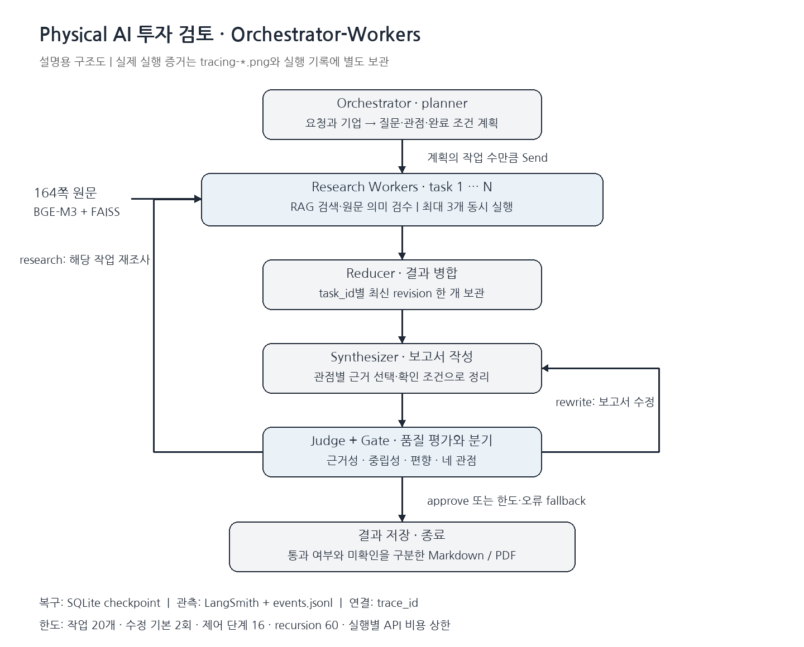
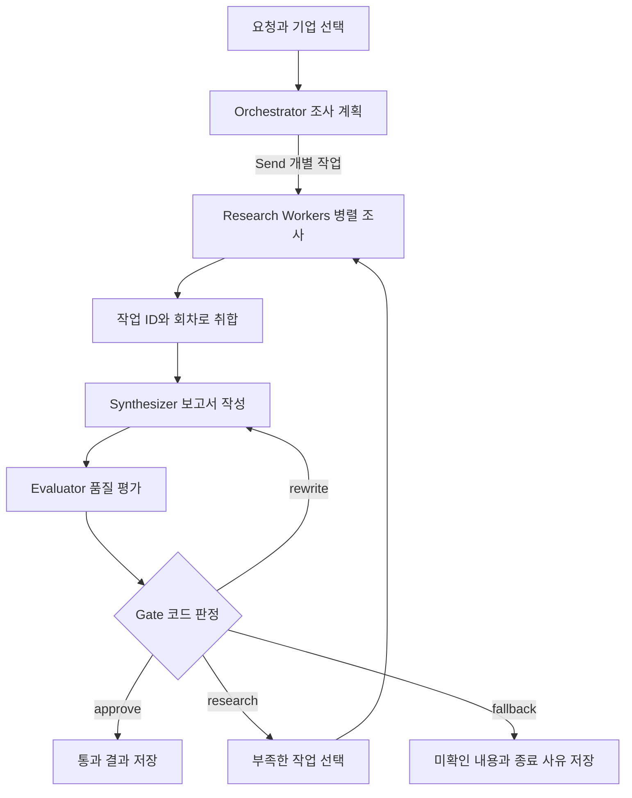

# Physical AI 스타트업 투자 분석 에이전트

## Subject

기존 RAG 과제에서 조사한 국내 Physical AI 스타트업을 대상으로, **필요한 조사를 계획하고 결과를 평가한 뒤 부족한 부분을 다시 처리하는 멀티 에이전트**를 만듭니다. 기술 성숙도·시장성·이해관계자·도메인 적용성을 근거와 함께 비교합니다.

기존 자료와 검색 코드를 이어 사용하고 흐름 제어를 확장했습니다. **최종 실행은 다섯 기업의 첫 보고서에서 네 품질 기준을 통과했고, 별도 프로세스의 중단·재개도 확인했습니다.** 아래 수치는 2026-10-13에 보존한 실제 실행 결과입니다.

처음 볼 때는 [과제 평가 보고서](submission/Agent_evaluation_report.pdf)로 목적과 결과를 먼저 읽습니다.
이어서 [최종 기업 분석](submission/final/report.md)에서 기업별 근거와 한계를 확인합니다.
실제 실행 과정은 [추적 안내](submission/trace-guide.md), 평가항목별 근거는 [100점 평가표 대응](docs/agent-rubric.md)에 있습니다.
[과제 범위](docs/agent-assignment.md) · [기존 RAG 기록](docs/README-rag-original.md) · [과제 GitHub 브랜치](https://github.com/nowjinpark/ai-startup-investment-agent/tree/agent-orchestration)

## Overview

### Objective

투자 검토자가 다섯 기업의 기술·사업 근거, 적용 가능성, 위험과 미확인 사항을 한 보고서에서 비교하도록 돕습니다. 공개 문서가 뒷받침하지 않는 매출·고객 수·투자 성과는 추정해서 채우지 않습니다. 자료가 오래됐거나 자격 확인이 남으면 그 한계를 표시합니다.

기본 분석 대상은 **로보아르테·로보콘·리옵스·비욘드허니컴·엔닷라이트**입니다. 기존 대상 조건은 국내 비상장 Seed~Series C 기업이며, 상장·Exit 완료 기업은 제외합니다. 현재도 이 조건을 충족하는지는 추가 확인합니다. 기존 과제의 검토 후보를 이어 조사하며, 국내 모든 기업 중 가장 우수한 다섯 기업이라고 주장하지 않습니다.

### Pattern 선정 이유

**Orchestrator-Workers + Evaluator-Optimizer**를 선택했습니다. 기업별 조사는 독립적으로 나눌 수 있으므로 먼저 조사 계획을 만들고 필요한 작업을 병렬 실행한 뒤 취합하는 구조가 맞습니다. 작성자와 평가자를 나누고, 평가에서 부족했던 부분을 다시 처리합니다.

Supervisor는 매 단계에서 다음 담당자를 정할 때 적합합니다. 이번에는 조사 전에 일을 나눌 수 있고 재처리 위치도 명확하므로 계획·조사·작성·평가가 보이는 작은 그래프를 사용합니다.

| 기존 고정 흐름 | 이번 동적 처리 |
|---|---|
| 모든 기업에 같은 기술·시장 분석을 실행했습니다. | LLM이 요청과 자료를 보고 조사 질문·검색어·작업 묶음을 만듭니다. |
| 분석을 모아 한 번 보고서를 만들었습니다. | `Send`로 계획된 작업을 실행하고 결과를 작업 ID별로 모읍니다. |
| 작성 후 끝났습니다. | 평가에 따라 통과·재조사·재작성·한도 종료로 나뉩니다. |

네 분석 관점은 모든 기업에 반드시 포함합니다. **필수 관점은 코드가 검사하고 구체적인 조사 계획은 LLM이 결정**합니다. 실제 실행에서는 다섯 기업의 조사를 10개 작업으로 나눴고, 한 기업의 네 관점을 묶어 달라는 요청에서는 1개 작업을 만들었습니다. 계획의 묶음은 달라도 네 관점 검사는 유지합니다.

## Selected Technologies

### 분석 대상으로 고른 SW와 HW

Physical AI에는 로봇 하드웨어뿐 아니라 환경을 이해하는 소프트웨어, 시뮬레이션 자료, 현장 운영 시스템도 필요합니다. 서로 다른 구성 요소를 비교할 수 있도록 기존 후보를 유지했습니다.

| 기업 | 자료에서 확인할 구성 요소 | 선정 이유 |
|---|---|---|
| 로보아르테 | 조리 로봇과 매장 자동화 HW·SW | 반복 조리 작업과 매장 운영의 연결을 살펴봅니다. |
| 로보콘 | 철근 가공·건설 자동화 로봇 HW·제어 SW | 설비와 현장 공정이 결합되는 사례를 봅니다. |
| 리옵스 | 공간 인식 SW와 현장 로봇 운영 | 공간을 이해하고 작업으로 연결하는 과정을 살펴봅니다. |
| 비욘드허니컴 | 조리 센서·로봇 HW와 조리 AI | 재료 상태를 측정하고 동작을 조정하는 구조를 봅니다. |
| 엔닷라이트 | 물리 정보를 담은 3D·시뮬레이션 SW | 로봇 학습용 데이터와 실제 현장 사이의 연결을 살펴봅니다. |

이는 **분석 범위를 고른 이유**입니다. SW가 HW보다 유리하다거나 특정 회사의 기술 우위가 입증됐다는 뜻은 아닙니다. 개별 주장은 저장된 원문과 연결해 확인합니다.

### 구현 환경

**Python 3.11.15, macOS arm64**에서 환경을 확인했습니다. 검색 임베딩은 CPU에서 실행할 수 있어 별도 GPU를 필수로 두지 않았습니다. LLM은 API로 호출하고 원문·캐시·중간 결과는 로컬에 보관합니다. [설치 환경 기록](submission/environment.json)과 [전체 설치 버전](submission/environment-lock.txt)에 실제 환경을 남겼습니다.

## Features

- **PDF 기반 자료 재사용:** 기존 원문 PDF 164쪽과 15개 후보의 준비 자료를 사용합니다. 2026-09-30 수집 스냅샷이며 현재 기업 상태의 최신성을 보장하지 않습니다.
- **네 관점 조사:** 기술 성숙도·시장성·이해관계자·도메인 적용성을 확인합니다. 이해관계자는 고객·사용자·투자자·공급자·규제 주체 등을 구분합니다.
- **확증편향 방지:** 장점뿐 아니라 반대 근거·위험·미확인을 함께 찾습니다. 투자자와 유료 고객, 계획과 완료 실적, 산업 통계와 기업 실적을 구분합니다.
- **품질 평가와 재처리:** 근거성·중립성·편향·충실성을 별도 평가자가 검사합니다. 자료가 부족하면 해당 작업을 다시 조사하고 구성 문제이면 보고서만 다시 작성합니다.
- **주장과 원문 검수:** 인용 문자열뿐 아니라 주체·시점·계획과 완료 여부를 대조합니다. 적합한 관점(`suitable_views`)을 확인한 근거 ID와 조건 코드만 보고서에 선택하고 URL로 출처를 표시합니다.
- **중간 결과 보존:** 원문과 요약을 따로 두고 작업 ID·수정 회차·오류·판정·실행 식별자로 결과를 연결합니다.

## Tech Stack

| 항목 | 선택과 기록 기준 |
|---|---|
| Framework | LangGraph 1.0.9, `StateGraph`·`Send`·조건부 분기 |
| LLM Generator | 실제 호출 별칭 `gpt-4.1-mini`: 계획·조사·보고서 근거 선택, temperature 0 |
| LLM Judge | 실제 호출 별칭 `gpt-4.1`: 원문 의미 검수·최종 품질 평가, temperature 0 |
| Retrieval | FAISS, 기본 상위 4개 청크, 기업별 검색과 공통 산업 자료 검색 |
| Retrieval 평가 | 기존 15문항을 이번 환경에서 재실행: **Hit Rate@4 1.0, MRR@4 0.956**. [실측 결과](submission/retrieval-evaluation.json) |
| Embedding | 오픈소스 `BAAI/bge-m3`, 로컬 dense 임베딩 1024차원 |
| 문서 분할 | `RecursiveCharacterTextSplitter`, 700자·겹침 100자 |
| 출력 검증 | Pydantic 구조화 출력, TypedDict State, 출처·필수 항목 검사 |
| 상태 저장 | `langgraph-checkpoint-sqlite` 2.0.11, 최신 `state.json`, 작업별 외부 기록 |
| 관측 | LangSmith와 로컬 실행 로그. 최종 승인·별도 프로세스 재개·실패 회귀 기록을 [추적 안내](submission/trace-guide.md)에 구분했습니다. |
| 보고서 | Markdown·한글 PDF. 과제 평가 보고서는 최대 10장입니다. |

모델명은 요청에 사용한 별칭이며 날짜가 붙은 응답 모델 스냅샷을 뜻하지 않습니다. [호출별 기록](submission/final/llm_usage.json)에 모델·단계·토큰을 보관했습니다. temperature 0이어도 새 실행의 문구·계획·시간이 같다고 보장하지 않습니다. 보존한 입력·결과·환경으로 당시 실행을 확인하고 저장 결과를 다시 보고서로 만들 수 있습니다.

BGE-M3는 한국어·영어 자료를 함께 검색하고 기존 캐시를 재사용할 수 있어 유지했습니다. 다른 임베딩보다 우수하다고 비교 실험한 것은 아닙니다. 검색 Hit Rate/MRR는 정답 문서를 찾은 정도이며 투자 판단 정확도나 과제 점수와 다릅니다. 기존 원문을 보고 구성한 15문항을 같은 코퍼스에서 다시 확인한 결과이므로 독립적인 외부 평가나 새 질문 전반의 성능으로 확대하지 않습니다.

## Agents

| 구성 | 하는 일 | 입력 → 출력 |
|---|---|---|
| Orchestrator | 조사 과제·검색어·완료 조건 결정 | 요청·기업 정보 → `Plan` |
| Research Worker | 맡은 기업과 관점을 RAG로 조사 | 개별 `Task` → 요약·주장·출처·한계 |
| Synthesizer | 검수된 근거 ID와 확인 조건 선택 | 결과·피드백 → 관점별 선택 → 코드가 기업 분석·비교 보고서 구성 |
| Evaluator | 네 품질 기준과 개선 이유 판정 | 보고서·근거 → `Evaluation` |
| Gate | 재처리·종료 결정 | 평가·오류·남은 횟수 → `approve/research/rewrite/fallback` |

Gate는 LLM 에이전트가 아니라 순수 함수입니다. LLM의 평가 의견 외에 코드가 필수 조건과 실행 한도를 함께 검사합니다.

## State Schema

State는 단계들이 주고받는 공용 기록입니다. [실제 선언](orchestration/state.py)에서 필드와 응답 형식을 확인할 수 있습니다.

| 구분 | 주요 필드 | 의미 |
|---|---|---|
| 입력 | `request`, `companies` | 요청과 대상 기업 |
| 계획·결과 | `plan`, `plan_reason`, `results`, `report` | 조사 계획, ID별 결과, 현재 보고서 |
| 평가 | `evaluation`, `feedback`, `pending_task_ids` | 판정, 개선 요청, 다시 조사할 작업 |
| 실행 제어 | `revision`, `max_revisions`, `step_count`, `route`, `status` | 회차·한도·경로·종료 상태 |
| 추적·오류 | `trace_id`, `node_status`, `last_error` | 같은 실행의 연결 정보와 실패 위치 |

### 일곱 가지 설계 기준

| 기준 | 적용 방법 |
|---|---|
| 제어 vs 페이로드 분리 | 조사 결과·보고서와 경로·횟수·상태를 구분합니다. Worker에는 개별 작업과 필요한 피드백만 전달합니다. |
| 관측성 위치 | `trace_id`, 순차 노드의 `node_status`, `last_error`와 `results`의 Worker 상태를 사용합니다. 상세 과정은 `events.jsonl`과 LangSmith에 남깁니다. |
| 지속성 비용 | 원문 PDF 전체를 매 단계 State에 복사하지 않습니다. 원문은 파일에, State에는 필요한 결과와 출처 ID를 둡니다. |
| 상관 | `trace_id`는 실행, `task_id`는 작업, `revision`은 수정 회차를 구분합니다. |
| 재개·복구 | SQLite checkpointer의 같은 `thread_id`로 재개합니다. 자료 해시·기존 비용을 확인하고 복원합니다. 한 기업 실행을 계획 뒤 중단하고 다른 프로세스에서 같은 계획을 재사용해 승인된 [재개 기록](submission/resume-proof/execution-segments.json)을 보관했습니다. |
| 동시 처리 | 최대 동시 실행 3개, `results` reducer는 높은 회차만 보관합니다. 같은 ID·회차의 서로 다른 결과는 충돌로 처리합니다. |
| 종료 보장 | 기본 수정 2회·제어 단계 16·그래프 recursion 60·비용 한도를 둡니다. 한도에 이르면 미달 사유를 남기고 fallback으로 끝냅니다. |

## Architecture



코드를 설명하기 위해 만든 구조도이며 실제 실행 추적 화면은 아닙니다. 그림의 한글·화살표·배치는 확인했습니다. 그래프 객체에서 생성하는 `graph.mmd`는 각 실행 폴더에 저장하고, 실제 실행 경로는 LangSmith 추적으로 별도 확인합니다. 아래 도식도 같은 구조를 설명합니다.



`research`는 근거 보강, `rewrite`는 표현·구성 보완입니다. 평가에서 유효한 재조사 작업 ID가 없으면 기존 계획 전체를 다시 조사합니다. Worker 실패는 즉시 한 번 재시도하고 실패 상태를 보존합니다. 같은 회사라도 요청에 따라 과제를 묶거나 나눌 수 있으며 계획은 최대 20개 작업으로 제한합니다.

## Directory Structure

```text
app.py                         새 멀티 에이전트 CLI
orchestration/                 계획·조사·작성·평가·분기
  state.py                     State와 구조화 출력
  graph.py                     동적 실행 그래프와 Gate
agents/                        기존 RAG 에이전트
prompts/                       새 역할별 지시문
data/prepared/                 164쪽 원문·15개 후보 준비 자료
rag.py                         기존 BGE-M3·FAISS 검색
outputs/agent-final/            실행별 상세 기록 (Git 제외)
submission/                    제출 보고서·그래프·추적 증거
  architecture.png             코드 흐름 설명 구조도
  Agent_evaluation_report.pdf  과제 평가 보고서
  final/                       최종 승인 실행·기업 분석
  resume-proof/                계획 후 중단·재개 증거
  rework-regression/           v3 실패·재처리 기록
  tracing-*.png                실제 LangSmith 캡처 (확보 현황은 trace-guide)
  trace-guide.md               실행별 수치·캡처 안내
main.py / workflow.py           이전 RAG 실행 방식
README.md
```

이전 `examples/final/`과 [기존 README](docs/README-rag-original.md)는 과거 RAG 결과입니다. 이번 과제의 최종 결과는 `submission/final/`입니다. `rework-regression/`은 최종 보고서로 사용하지 않는 실패 검증 기록입니다.

## Usage

Python 3.11을 사용합니다. 제출 ZIP을 풀었다면 `source/` 폴더에서 아래 명령을 실행합니다. 이 폴더에는 164쪽 준비 자료인 `data/prepared/`가 포함됩니다. GitHub 코드만 받았다면 같은 준비 자료를 별도로 넣어야 합니다. 아래 명령은 실제 실행한 CLI 기준입니다. 전체 설치 버전은 [환경 고정 목록](submission/environment-lock.txt)에 보관했습니다.

```bash
python3.11 -m venv .venv
./.venv/bin/python -m pip install -r requirements.txt
cp .env.example .env
```

`.env`에 본인의 `OPENAI_API_KEY`와 `LANGSMITH_API_KEY`를 입력합니다. CLI는 제출용 추적을 켜고 프로젝트를 `skala-physical-ai-orchestration`으로 구분합니다. 값은 Git에 올리지 않습니다. 준비 자료는 `data/prepared/manifest.json`과 `corpus/sources.json`이 보이도록 둡니다. 자료가 없거나 해시가 다르면 자동 재수집하지 않고 중단합니다.

```bash
./.venv/bin/python app.py live \
  --companies '로보아르테,로보콘,리옵스,비욘드허니컴,엔닷라이트' \
  --output outputs/agent-final

./.venv/bin/python app.py report --output outputs/agent-final
```

중단·재개를 확인할 때는 별도 폴더에서 실행합니다. 첫 명령이 끝난 뒤 두 번째 명령을 새 프로세스로 실행합니다.

```bash
./.venv/bin/python app.py live \
  --companies '로보아르테' \
  --request '로보아르테 한 기업의 기술 성숙도·시장성·이해관계자·도메인 적용성을 하나의 조사 작업으로 묶어서 검토해 주세요. 출처가 있는 사실과 추가 확인사항을 구분하고 투자 확정 추천은 하지 마세요.' \
  --output outputs/agent-resume --pause-after-plan

./.venv/bin/python app.py resume --output outputs/agent-resume
```

- `live`: 실제 LLM을 호출합니다. 기존 실행 폴더를 덮어쓰지 않습니다. 임베딩 모델 첫 다운로드에는 시간이 걸릴 수 있습니다.
- `resume`: 같은 출력 폴더의 checkpoint와 비용을 복원합니다. 이미 종료된 실행은 재개하지 않습니다. 원래 비용 한도가 기본값과 달랐다면 같은 `--max-cost-usd`를 지정합니다.
- `report`: 저장 결과로 `evaluation-report.pdf`를 다시 만듭니다. 새 조사를 시작하지 않습니다.
- `--env-file '/본인/경로/.env'`: 기존 수업 환경 파일을 선택합니다. 기본은 프로젝트 `.env`이며 기존 환경변수를 덮어쓰지 않습니다.
- `--data`: 준비 자료 폴더를 지정합니다. `--request`로 비교 목적을 바꿀 수 있습니다. 기업은 준비 후보에서 서로 다른 1~5개를 선택합니다.
- `--max-cost-usd`: 실행당 추정 API 비용 한도, 기본 3달러·최대 10달러입니다. 공급자의 실제 청구액과 구분합니다.
- `--max-revisions`: 첫 보고서 이후 추가 수정 회수, 기본 2·최대 3입니다.
- `--pause-after-plan`: 계획 뒤 중단해 재개를 확인합니다. 재개 시 이 옵션은 빼고 실행합니다.
- `--no-trace`: LangSmith 없는 로컬 확인용입니다. 이 실행은 필수 추적 증거를 대신하지 못합니다.

최신 상태는 `state.json`, 계획·분기 이유는 `events.jsonl`, 요약은 `execution-summary.json`, 추적 연결은 `trace.json`, 투자 분석 본문은 `report.md`에 저장합니다. 보존한 최종 실행은 `submission/final/`, 재개는 `submission/resume-proof/`에서 확인합니다. 새 실행은 별도 출력 폴더를 사용합니다.

## 실행 결과와 평가

| 실제 실행 | 최종 v7 | 중단·재개 검증 |
|---|---:|---:|
| 기업·초기 작업 | 5개·10개 | 1개·1개 |
| Worker 실행 | 10회, 실제 최대 동시 실행 3개 | 1회 |
| 작성·평가 | 각각 1회 | 각각 1회 |
| 추가 수정 회차 | 0 | 0 |
| LLM 호출 | 26회 | 중단 전 포함 5회 |
| 로컬 누적 실행 시간 | 53.701초 | 23.456초 |
| 추정 API 비용 | $0.286734 | $0.048427 |
| 종료 | `approved` | `approved`, `resumed=true` |

최종 실행은 근거성·중립성·편향·충실성 검사를 첫 평가에서 통과했습니다. 26회 호출에는 계획 1회·조사 10회·원문 검수 13회·작성 선택 1회·평가 1회가 포함됩니다. 원문 검수 13회 중 3회는 부족한 관점을 같은 원문에서 다시 확인한 Worker 내부 복구입니다. 보고서 평가 뒤의 재조사 회차와 구분합니다. [최종 실행 요약](submission/final/execution-summary.json) · [재개 요약](submission/resume-proof/execution-summary.json)

시간은 로컬 실행 구간의 합계이며 재개를 기다린 시간은 포함하지 않습니다. 비용은 토큰 사용과 설정 단가에 따른 추정치로 실제 청구액이 아닙니다. LangSmith 화면의 시간·비용과 집계 범위가 다를 수 있습니다.

| 확인한 항목 | 결과와 근거 |
|---|---|
| 입력별 동적 계획 | 다섯 기업 10개 작업과 한 기업 1개 작업의 [계획·추적](submission/trace-guide.md) |
| 최종 품질 | Worker 내부 근거 검수·복구 뒤 첫 보고서의 네 기준 승인, [실행 기록](submission/final/events.jsonl) |
| 재작성·한도 종료 | v3의 rewrite → research → fallback, [실패 회귀 기록](submission/rework-regression/README.md) |
| 중단 후 재개 | 계획 유지·비용 복원·동일 trace_id의 [두 실행 구간](submission/resume-proof/execution-segments.json) |
| 검색 | 기존 15문항의 Hit Rate@4 **1.0**, MRR@4 **0.956**, [실측](submission/retrieval-evaluation.json) |
| 코드 검사 | **347 passed, 1 skipped, 4 subtests passed**, 6.05초, [기록](submission/test-results.txt) |
| 과제 보고서 | [평가 PDF](submission/Agent_evaluation_report.pdf) **6쪽**, 기업 분석과 추적 증빙은 별도 연결 |

생략한 1개 검사는 `RUN_NETWORK_TESTS=1`을 요구하는 원문 재수집 검사입니다. 이번에는 보존한 164쪽을 사용했습니다. 경고 3개는 FAISS SWIG 타입의 deprecation 경고입니다. 단위·통합 검사와 실제 API 실행은 별도 증거로 구분합니다.

보고서의 품질 승인과 투자 적합성 확정은 다릅니다. [과제 100점 평가표 대응](docs/agent-rubric.md)은 항목별 구현과 검증 근거이며 만점 보장이 아닙니다.

## 근거 검증에서 보완한 점

인용문이 원문에 존재해도 그 인용에 붙인 해석이 맞는지는 따로 확인해야 했습니다. 회사 발표를 독립 실측으로 설명하거나 계획을 완료 성과로 표현하면, 문자열이 정확해도 의미가 달라집니다. v3는 재작성과 두 작업 재조사를 수행했지만 품질 미달로 수정 한도에서 종료했습니다.

최종 v7은 원문 의미 검수에서 주장과 출처 URL, 주체·시점·완료 여부, 해당 관점에 적합한지를 확인합니다. 보고서 모델은 검수된 `finding_id`와 `condition_codes`를 선택합니다. 코드는 `suitable_views`에 맞는 근거만 연결하고 선택된 원문 주장·인용·확인 조건을 조립합니다. 피드백이 있으면 근거 선택과 조건을 바꿀 수 있으나 새 사실을 임의로 덧붙이지 않습니다. 필수 관점의 근거가 비면 같은 원문에서 짧은 사실을 한 번만 다시 뽑아 검수하며 최초 판정도 보존합니다. 작성 모델의 선택이 빠졌어도 적합하다고 검수된 후보가 있을 때만 허용된 ID로 보완하고 변경 기록을 남깁니다. 그래도 적합한 근거가 없으면 미확인으로 남기며 필요한 작업을 재조사합니다.

최종 승인에도 원문 자체의 오류·홍보 편향·정보 노후화와 LLM 평가의 한계는 남습니다. 최신 기업 자격, 유료 계약, 독립 성능, 시장 규모·매출은 추가 확인 대상입니다.

## Contributors

동일한 다섯 팀원이 이어서 진행합니다. 아래는 기존 RAG에서 정한 개인 역할입니다. 이번 확장의 새 완료 작업을 임의로 배정하지 않았습니다.

| 팀원 | 기존 개인 역할 |
|---|---|
| 박종찬 | 스타트업 탐색·기업 자격·자료 준비 |
| 김민정 | 기술 분석·기술 근거 확인 |
| 김희윤 | 시장·경쟁 분석·고객과 사업 근거 확인 |
| 이현우 | 투자 판단·평가표·점수 계산 |
| 박진원 | 보고서 생성·통합 실행·보고서 검토 |

이번 그래프·원문 검수·평가 루프·문서 작성·실행 검증에는 Codex를 활용했습니다. 팀원별 새 검토·수정·실행 내역은 실제 확인된 작업만 추가합니다. PM·PL 같은 관리 직함을 개인 구현 역할 대신 적지 않습니다.

## References

- [Multi-Agent Orchestration 실습 안내](https://actually-war-1ea.notion.site/Multi-Agent-Orchestration-3d57f4c866938020a992fcc97e942ee6): 본문·펼침 README 샘플·평가표. 샘플은 정답이 아니라 조별 설계 근거에 맞춰 바꾸는 참고 형식입니다.
- 배기주, 「생성형AI 7 AI Agent 설계 및 구축」: PDF 59–79쪽의 설계·패턴, 118–137쪽의 State·병렬 처리, 145–169쪽의 원문 보존·평가·재시도. 페이지는 PDF 뷰어 기준입니다.
- 수업 `12-Pattern/04-Orchestrator-Workers.ipynb`, `10-Agent/30-Agent-Evaluation.ipynb`: 구조화 계획·Send·평가 흐름을 참고했습니다.
- [LangGraph Workflows and agents](https://docs.langchain.com/oss/python/langgraph/workflows-agents): Orchestrator-Workers와 Evaluator-Optimizer 공식 설명.
- [LangGraph Persistence](https://docs.langchain.com/oss/python/langgraph/persistence): checkpoint와 실행 재개.
- [LangSmith Observability quickstart](https://docs.langchain.com/langsmith/observability-quickstart): 실제 실행 추적 설정.
- [기존 RAG 개발 기록](docs/README-rag-original.md), `data/prepared/corpus/sources.json`: 기업별 원문 제목·URL·페이지·수집 시점의 근거입니다.
