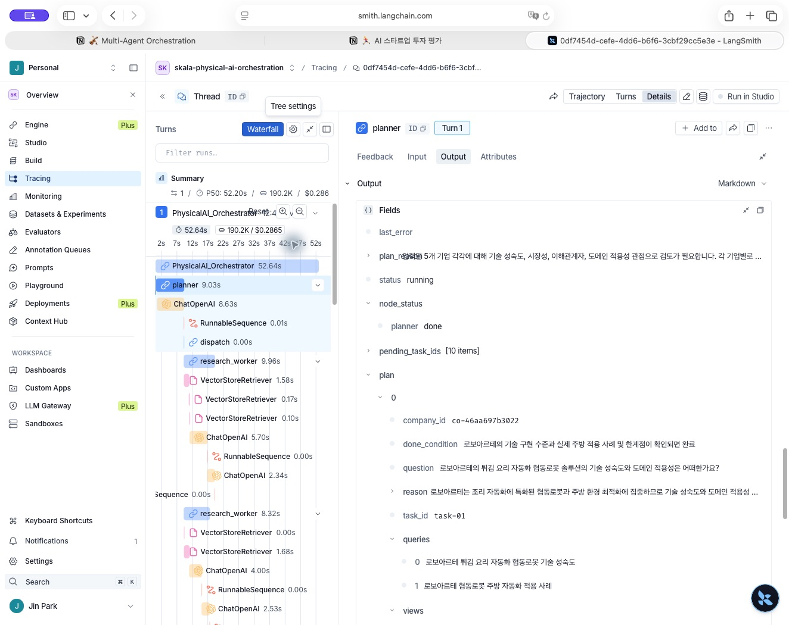
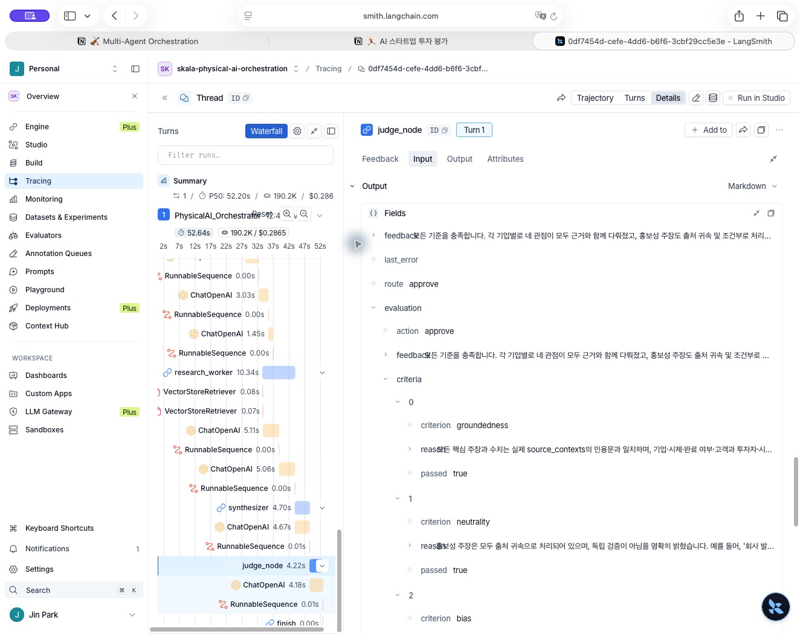
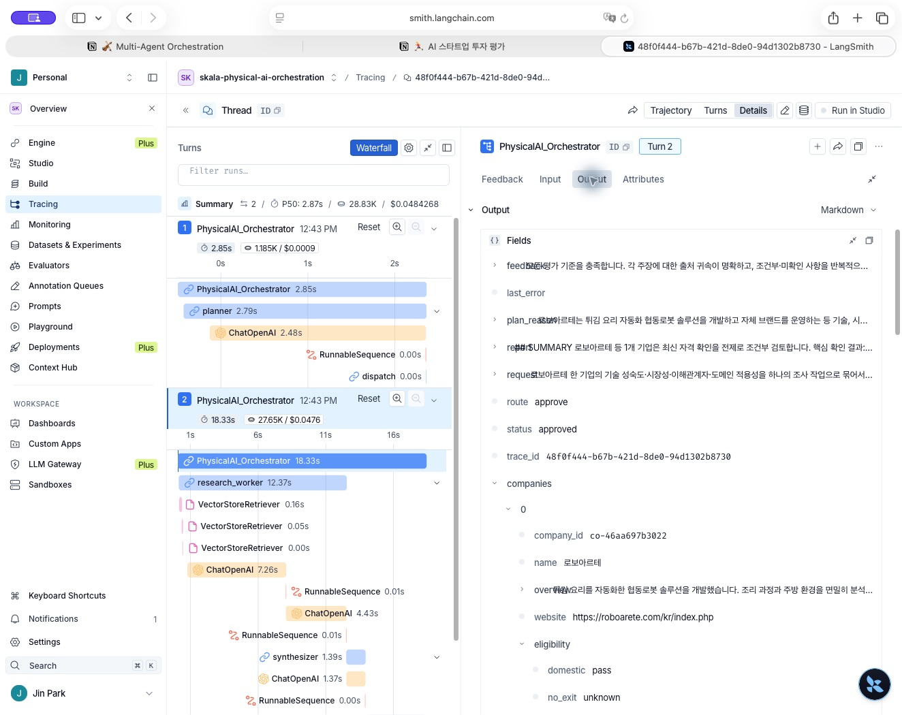
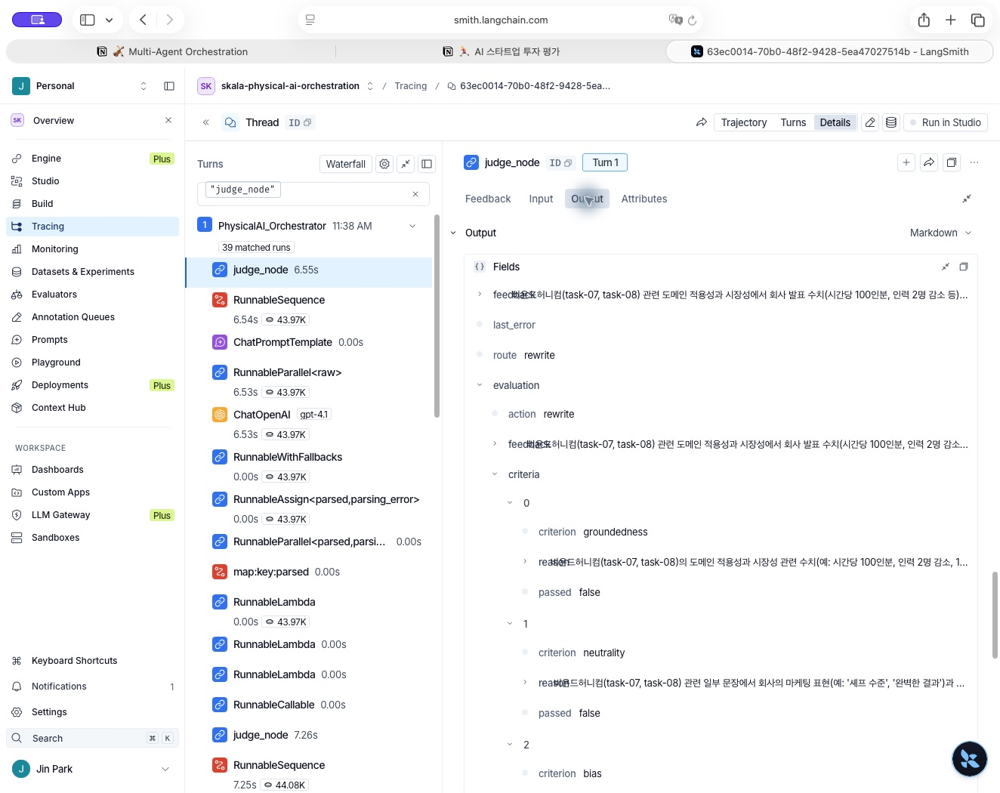
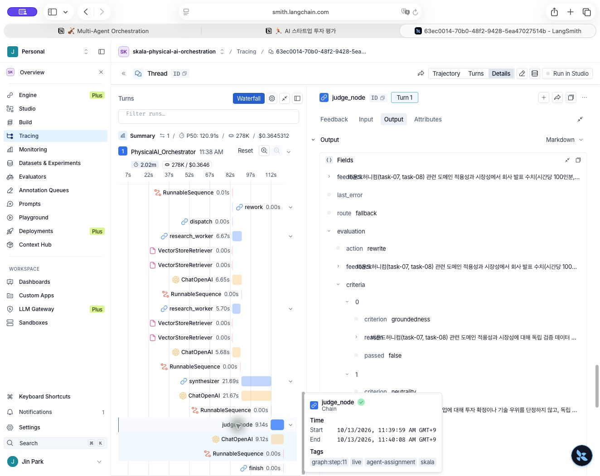

# 실행 추적 읽는 방법

## 먼저 구분할 기록

| 기록 | 위치 | 뜻 |
|---|---|---|
| 최종 v7 | [final/](final/) | 다섯 기업의 네 관점 보고서가 품질 검사를 통과한 제출 실행 |
| 중단·재개 v7 | [resume-proof/](resume-proof/) | 한 기업의 계획 뒤 종료하고 새 프로세스에서 이어 실행한 증거 |
| 실패 회귀 v3 | [rework-regression/](rework-regression/README.md) | 재작성·선택 재조사·한도 종료를 보존한 과거 실패 기록 |

`architecture.png`는 코드를 설명하는 구조도입니다. 실제 실행은 LangSmith 조회 결과와 로컬 기록을 연결해 확인합니다. LangSmith의 초록 체크는 호출 종료 표시이며 보고서의 품질 승인은 `evaluation`과 `status`로 따로 확인합니다. 조회 링크는 권한이 있는 계정에서 열 수 있습니다.

## 최종 v7 실행

- 실행 식별자 `trace_id`: `0df7454d-cefe-4dd6-b6f6-3cbf29cc5e3e`
- LangSmith 루트 `run_id`: `ec9b7fbd-120b-412f-9443-76f8ad39c332`
- [실제 LangSmith 실행](https://smith.langchain.com/o/bf72d5b6-8fb0-4606-a88b-9acdd0ce8f19/a/skala-physical-ai-orchestration/projects/p/013499dc-bd15-4128-8696-462d39dfbf0a/t/0df7454d-cefe-4dd6-b6f6-3cbf29cc5e3e?run_id=ec9b7fbd-120b-412f-9443-76f8ad39c332&trace_id=ec9b7fbd-120b-412f-9443-76f8ad39c332)
- [실행 요약](final/execution-summary.json) · [API로 조회한 추적 검증](final/trace-verification.json) · [작성·평가 원본 출력](final/report-versions.json)

| 항목 | 실제 값 |
|---|---|
| 입력·계획 | 다섯 기업, 10개 조사 작업 |
| Worker | 10회, 실제 최대 동시 실행 3개 |
| 작성·최종 평가 | 각각 1회, 추가 수정 회차 0 |
| LLM 호출 | 26회: Plan 1 + Research 10 + GroundingReview 13 + Report 1 + Evaluation 1 |
| 로컬 실행 시간 | 53.701초 |
| 추정 API 비용 | $0.286734 |
| 최종 상태 | `approved`, 근거성·중립성·편향·충실성 통과 |

세 Worker에서 부족한 관점의 근거를 같은 원문으로 한 번씩 더 검수해 GroundingReview가 13회입니다. 이 Worker 내부 복구는 보고서 평가 후의 재조사 회차와 다릅니다. 최초 검수·복구 기록을 `raw/`에 함께 보존했고, 보고서 선택의 원래 응답과 보완은 `raw/report-0.json`에 남겼습니다. 실제 작성 결과는 9,316자이며 길이 자체를 품질 점수로 쓰지 않습니다.

최종 실행은 첫 보고서에서 승인됐으므로, 이 실행이 보고서 평가 후 `rewrite`나 `research`를 거쳤다고 설명하지 않습니다. 해당 경로의 실제 증거는 아래 v3 기록으로 구분합니다.

오른쪽에 `pending_task_ids [10]`과 `task-01`의 질문·완료 조건·검색어가, 왼쪽에 Planner와 Worker의 Waterfall이 보입니다. 최대 동시 실행 3개는 화면의 인상으로 센 값이 아니라 [추적 검증](final/trace-verification.json)의 실제 시작·종료 시간으로 확인했습니다.

`route=approve`, `action=approve`와 근거성(`groundedness`)·중립성(`neutrality`)의 `passed=true`가 보입니다. 편향·충실성은 이 화면 아래에 있으므로 [평가 원본](final/raw/evaluation-0.json)에서 네 항목을 모두 확인합니다.

## 별도 프로세스의 중단·재개

한 기업의 네 관점을 하나의 작업으로 묶어 달라는 입력에서 1개 계획을 만들었습니다. `--pause-after-plan`으로 첫 프로세스를 끝낸 뒤 새 프로세스에서 `resume`을 실행했습니다.

- 공통 `trace_id`: `48f0f444-b67b-421d-8de0-94d1302b8730`
- 중단 구간 `run_id`: `e49944c7-d605-439a-97c6-d2b6cd65bb9e` — [계획 뒤 중단](https://smith.langchain.com/o/bf72d5b6-8fb0-4606-a88b-9acdd0ce8f19/a/skala-physical-ai-orchestration/projects/p/013499dc-bd15-4128-8696-462d39dfbf0a/t/48f0f444-b67b-421d-8de0-94d1302b8730?run_id=e49944c7-d605-439a-97c6-d2b6cd65bb9e&trace_id=e49944c7-d605-439a-97c6-d2b6cd65bb9e)
- 재개 구간 `run_id`: `3f0f53a2-4e95-4dfa-b52c-627ddf7c9d40` — [재개 뒤 승인](https://smith.langchain.com/o/bf72d5b6-8fb0-4606-a88b-9acdd0ce8f19/a/skala-physical-ai-orchestration/projects/p/013499dc-bd15-4128-8696-462d39dfbf0a/t/48f0f444-b67b-421d-8de0-94d1302b8730?run_id=3f0f53a2-4e95-4dfa-b52c-627ddf7c9d40&trace_id=3f0f53a2-4e95-4dfa-b52c-627ddf7c9d40)

[두 실행 구간](resume-proof/execution-segments.json)과 [추적 검증](resume-proof/trace-verification.json)을 함께 봅니다. 첫 구간에는 Planner 1회가 있고 재개 구간에는 Planner가 없습니다. 재개 구간은 Worker·작성·평가 각 1회 뒤 `approved`로 끝났습니다. 완료한 계획과 기존 비용을 재사용한 증거입니다.

누적 호출은 **5회**, 로컬 구간 시간은 **4.079 + 19.377 = 23.456초**, 추정 비용은 **$0.048427**입니다. 두 프로세스 사이의 대기 시간은 제외했습니다. 실제 추적에서 첫 구간의 최대 동시 Worker는 0개, 재개 구간은 1개입니다.

왼쪽 첫 구간에는 Planner(2.79초), 두 번째 구간에는 Research Worker(12.37초)와 작성 흐름이 보입니다. 오른쪽의 `status=approved`와 `trace_id=48f0f444-b67b-421d-8de0-94d1302b8730`을 [두 실행 구간](resume-proof/execution-segments.json)과 대조했습니다. 화면의 개별 노드 시간은 위의 로컬 누적 실행 시간과 집계 범위가 다릅니다.

## 화면별 확인 내용

| 파일 | 연결된 실행·화면 | 확인한 내용 |
|---|---|---|
| `tracing-1.png` | 최종 v7 계획과 병렬 Worker 흐름 | 10개 예정 작업·개별 계획·Worker Waterfall |
| `tracing-2.png` | 최종 v7 품질 승인 | approve 경로·근거성/중립성 통과, 나머지 항목은 JSON 연결 |
| `tracing-3.png` | v3 첫 평가의 rewrite | 실제 재작성 분기와 품질 미달 |
| `tracing-4.png` | v3 재조사 후 fallback | 두 Worker 재조사 뒤 수정 한도 종료 |
| `tracing-5.png` | v7 한 기업의 재개 흐름 | 같은 trace_id의 두 구간과 재개 후 approved |

다섯 장 모두 실제 LangSmith 화면을 캡처하고 조회 결과의 실행 식별자와 대조했습니다. 화면에서 긴 설명이나 아래쪽 항목이 잘린 경우 연결된 평가 JSON을 함께 읽습니다.

## v3에서 실제로 일어난 일

- 로컬 실행: `outputs/agent-final-v3/`
- 실행 식별자 `trace_id`: `63ec0014-70b0-48f2-9428-5ea47027514b`
- LangSmith `run_id`: `bdd61f77-8ff1-4815-9e98-5aba22aeaed5`
- [실제 LangSmith 실행](https://smith.langchain.com/o/bf72d5b6-8fb0-4606-a88b-9acdd0ce8f19/a/skala-physical-ai-orchestration/projects/p/013499dc-bd15-4128-8696-462d39dfbf0a/t/63ec0014-70b0-48f2-9428-5ea47027514b?run_id=bdd61f77-8ff1-4815-9e98-5aba22aeaed5&trace_id=bdd61f77-8ff1-4815-9e98-5aba22aeaed5)

조회 권한이 있는 계정에서 링크를 열 수 있습니다. 화면과 로컬 `trace-verification.json`의 run ID를 대조했습니다.

| 회차 | 평가 뒤 경로 | 실제 처리 |
|---|---|---|
| 0 | `rewrite` | 회사 발표 수치와 독립 검증 결과의 구분이 부족하다는 평가를 받아 보고서만 다시 작성했습니다. |
| 1 | `research` | 비욘드허니컴의 `task-07`, `task-08`을 추가 조사했습니다. 다른 완료 작업은 유지했습니다. |
| 2 | `fallback` | 평가자는 다시 수정을 제안했지만 추가 수정 한도 2회에 도달해 Gate가 종료했습니다. |

초기 계획은 5개 기업·10개 작업입니다. 추가 조사 2개를 합쳐 Worker는 12회, 작성과 평가는 각각 3회 실행됐습니다. LLM 호출은 19회이며 최종 상태는 `fallback`입니다. 이 수치는 v3 기록에만 해당하며 최종 실행 결과와 합산하지 않습니다.

LangSmith에서 실제 작성·평가 노드의 출력을 조회한 `report-versions.json`도 보존했습니다. 보고서 세 판은 각각 **14,054자 → 14,239자 → 14,502자**이며, 중간 평가 세 건과 함께 변경 전후를 비교할 수 있습니다. 이는 실제 재작성과 선택 재조사의 증거입니다. 글자 수 증가나 문장 변경 자체를 품질 개선 성공으로 해석하지 않습니다. 실제 세 판과 평가 세 건은 [보존한 출력](rework-regression/report-versions.json)에서 확인합니다.

### 첫 품질 평가와 재작성

`route=rewrite`, `groundedness=false`, `neutrality=false`를 확인할 수 있습니다. 작성과 평가를 분리하고 평가 결과가 실제 분기에 사용된 증거입니다. 긴 판정 이유는 화면에서 잘리므로 로컬 평가 JSON과 함께 읽습니다.

### 재조사 후 한도 종료

왼쪽에는 두 Worker의 재조사 뒤 작성·평가·종료 흐름이, 오른쪽에는 `route=fallback`과 `groundedness=false`가 보입니다. 평가의 `action=rewrite`와 Gate의 `route=fallback`이 다른 것은 오류가 아니라 수정 한도를 적용한 결과입니다.

LangSmith 노드의 초록 체크는 호출이 예외 없이 끝났다는 뜻입니다. **보고서 품질 통과 여부는 State의 평가와 `status`를 확인**해야 합니다. 이 실행의 루트 호출 오류가 없어도 결과는 품질 미달에 따른 fallback입니다.

## 최종 구현의 근거 검수

문자열 검사는 인용문이 원문에 존재하는지 확인합니다. 그러나 같은 인용을 붙여도 다른 회사의 실적으로 해석하거나, 계획을 완료 성과로 바꾸거나, 회사 발표를 독립적인 실측 결과로 표현할 수 있습니다. **인용문 일치와 주장 의미의 정확성은 별도 문제**입니다.

최종 구현은 Worker의 주장과 연결된 원문·URL을 의미 수준에서 대조합니다. 주체·시점·완료/계획·발표/독립 검증 여부와 해당 관점에 적합한지를 확인합니다. 보고서 모델은 검수된 근거 ID와 조건 코드를 고르고, 코드는 허용된 원문 주장·출처·추가 확인 조건을 조립합니다. 피드백 뒤에는 근거 선택과 조건을 바꿀 수 있습니다. 인용 문자열 검사, 주장 의미 검수, 최종 보고서 평가는 서로 다른 단계입니다.

LLM 평가도 오류나 일관성 한계가 있을 수 있습니다. v3 평가자가 지적한 모든 문장이 객관적으로 틀렸다는 결론 대신, 어떤 이유로 재처리했고 언제 종료했는지를 보존합니다.

## 수치와 재현 범위

시간은 로컬 실행 구간 합계, 비용은 기록된 토큰과 설정 단가에 따른 추정값입니다. LangSmith 화면의 집계 범위와 공급자 실제 청구액은 다를 수 있습니다. 호출 모델명은 `gpt-4.1-mini`·`gpt-4.1` 별칭이며 날짜별 응답 스냅샷을 확보한 것은 아닙니다.

`run-config.json`은 입력·자료 해시·실행 코드 해시를, `graph.mmd`는 실제 그래프 객체의 구조를 보관합니다. 같은 자료·코드인지와 재개에서 계획을 반복하지 않는지를 따로 확인했습니다. temperature 0이어도 새로운 실행의 계획·문장·시간이 같다고 보장하지 않습니다. 보존된 기록으로 당시 실행을 확인하는 범위와 새 실행 결과를 구분합니다.

서로 다른 실행의 보고서·수치·추적 이미지를 섞지 않습니다. v3 실패 결과는 투자 판단에 사용하지 않으며, 최종 품질 승인도 투자 적합성이나 과제 만점을 뜻하지 않습니다.
